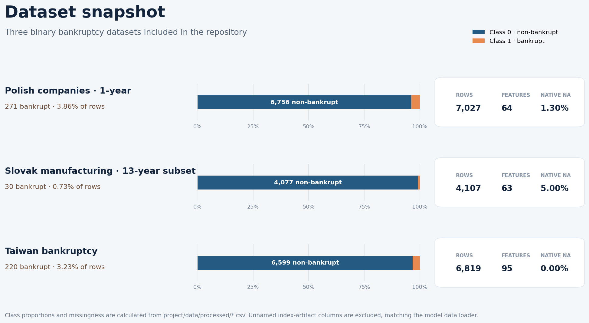
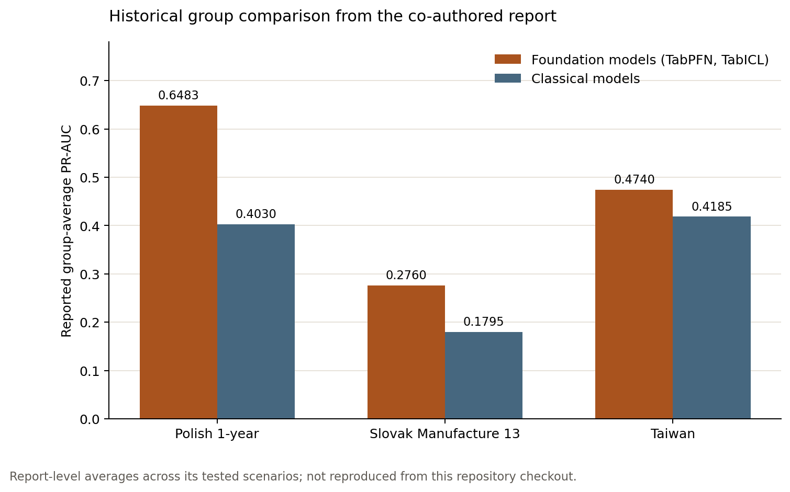
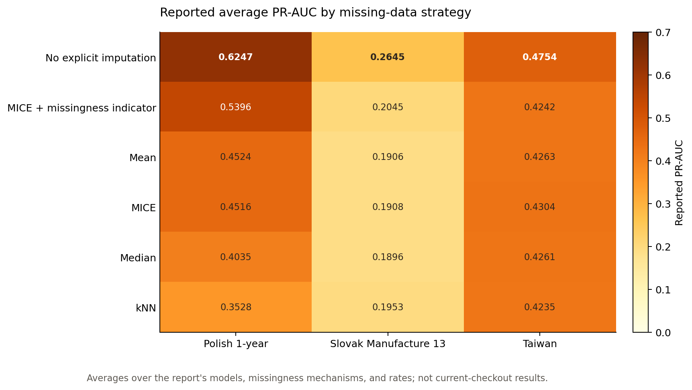
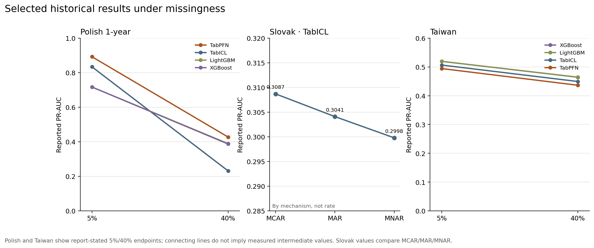
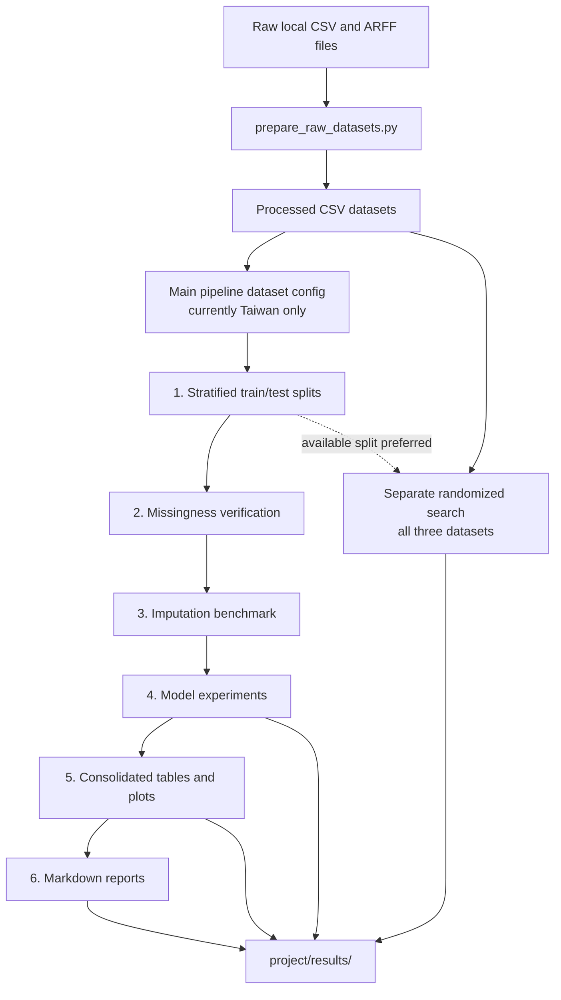

# Tabular Models with Missing Data

A research benchmark for comparing classical machine-learning models and pretrained tabular models on bankruptcy classification with controlled missing data.

## Dataset snapshot



*The chart is calculated from the committed processed CSV files. It shows the severe class imbalance and the different amounts of native feature missingness present before any synthetic masking.*

## Overview

This project studies how model choice and imputation strategy affect binary bankruptcy classification when tabular features are incomplete. It includes three processed datasets, utilities for simulating MCAR, MAR, and MNAR missingness, an experiment runner, and a separate randomized hyperparameter-search pipeline.

This repository contains experiment code and input datasets, but no committed benchmark result tables. Treat it as a reproducible research pipeline rather than as a report of established model rankings.

A co-authored technical report records historical findings from a broader experiment. Its reported PR-AUC comparisons, TabPFN/TabICL results, missingness response, imputation comparison, authorship context, and reproduction limits are summarized in [the research summary](docs/research-summary.md). The three charts below were newly drawn from numeric tables and values in that report; they are not the report's original figures and have not been reproduced from this checkout.

### Historical report results (not reproduced here)







### Current execution scope

The repository contains three datasets, but the main pipeline currently activates only `taiwan_bankruptcy` in `project/src/config.py`. Its split preparation, missingness checks, imputation benchmark, and default experiment matrix therefore run on Taiwan only. The separate randomized-search script registers all three datasets.

| Pipeline | Current dataset scope |
| --- | --- |
| `src/run_experiments.py` | Taiwan only, as configured in `src/config.py` |
| `src/random_search_pipeline.py` | Polish, Slovak manufacturing, and Taiwan |

This distinction matters when comparing results or reproducing the full study. See [experiment design](docs/experimental-design.md) and [architecture](docs/architecture.md).

## Included datasets

The following statistics are calculated from the CSV files in `project/data/processed/`. Feature counts and native missingness exclude `Unnamed:` index-artifact columns, matching the model data loader.

| Dataset | Rows | Features | Bankrupt (`target = 1`) | Native feature missingness | Source noted in repository |
| --- | ---: | ---: | ---: | ---: | --- |
| Polish companies, 1-year subset | 7,027 | 64 | 271 (3.86%) | 1.30% | [UCI Polish Companies Bankruptcy](https://archive.ics.uci.edu/dataset/365/polish%2Bcompanies%2Bbankruptcy%2Bdata) |
| Slovak manufacturing, 13-year subset | 4,107 | 63 | 30 (0.73%) | 5.00% | [Mendeley Data, v2](https://data.mendeley.com/datasets/j89csb932y/2) |
| Taiwan bankruptcy | 6,819 | 95 | 220 (3.23%) | 0.00% | [UCI Taiwanese Bankruptcy Prediction](https://archive.ics.uci.edu/dataset/572/taiwanese%2Bbankruptcy%2Bprediction) |

The Slovak files are merged from the bankrupt and non-bankrupt manufacturing CSVs under `project/data/raw/slovak/`; their filenames match the records in the upstream Mendeley dataset. The upstream dataset pages for all three sources identify CC BY 4.0. Dataset references and attribution are collected in [data-attribution.md](docs/data-attribution.md). The repository does not include a license for its own code.

## Technology stack

The declared stack is Python, pandas, NumPy, SciPy, and scikit-learn for data preparation and evaluation; PyTorch, TabPFN, TabICL, XGBoost, LightGBM, and CatBoost for model experiments; and Matplotlib/Seaborn for visualizations. `python-docx` and Pillow are included for the separate DOCX report generator.

## Implemented workflow

The main pipeline in `project/src/run_experiments.py` has six steps:

1. Create stratified 80/20 train/test splits for the datasets enabled in `config.py` (currently Taiwan), using split seeds `42` and `123`.
2. Check whether synthetic missingness reaches the requested rates.
3. Benchmark imputation methods on the configured datasets.
4. Run the model experiment matrix and save each completed result so the run can resume.
5. Consolidate results and create visualizations.
6. Generate Markdown reports.

The experiment configuration defines eight classical models (Logistic Regression, Random Forest, Gradient Boosting, XGBoost, LightGBM, SVM, MLP, and CatBoost) and two pretrained tabular models (TabPFN and TabICL). Imputation options are mean, median, KNN, iterative imputation (MICE), MICE with missingness indicators, and no explicit imputation for supported estimators.

The benchmark reports average precision as `pr_auc`, along with balanced accuracy, macro F1, class-1 recall, ROC-AUC, and other classification metrics. Classical models use class weighting where supported. The configured decision threshold is selected on a stratified holdout from the training data using balanced accuracy.

The separate `random_search_pipeline.py` tunes the eight classical models. Its defaults are 150 sampled parameter configurations per model, five-fold stratified cross-validation, and three seeds. It ranks parameter configurations using average precision and also records balanced accuracy. A default full search requests roughly 54,000 model fits, so start with the smoke command below before launching it.

## Technical highlights

- Missingness injection and imputation are separate from model construction, which makes experiment scenarios explicit.
- Stratified splits, repeated seeds, and imbalance-sensitive metrics support comparisons on datasets with few positive examples.
- The main runner can resume completed combinations and writes each experiment result atomically.
- Randomized search samples a shared set of candidate settings per model, then compares those candidates across datasets and CV seeds.

## Architecture



All generated tables, reports, plots, and logs are written under `project/results/`, which is ignored by Git. The flow and its dataset-scope caveats are described in [architecture.md](docs/architecture.md).

## Getting started

The processed CSVs required by the experiment scripts are included in the repository. From PowerShell, change into the `project` directory and create an isolated environment:

```powershell
cd path\to\missing-data-tabular-models\project
py -3 -m venv .venv
.\.venv\Scripts\Activate.ps1
python -m pip install --upgrade pip
python -m pip install -r requirements.txt
```

The requirements file includes scikit-learn and the optional model libraries, including PyTorch, TabPFN, TabICL, XGBoost, LightGBM, and CatBoost. It does not pin package versions or declare a supported Python version. Installation and compatibility of the complete model stack should be checked in the target environment. TabPFN also requires its configured access token for the repository's preflight check; without it, the runner skips that model.

Create train/test splits before running steps that need them:

```powershell
python src\run_experiments.py --step 1
```

With the current configuration, this creates splits for `taiwan_bankruptcy` only.

### Quick smoke runs

Run one main-pipeline scenario with Logistic Regression:

```powershell
python src\run_experiments.py --step 4 `
  --datasets taiwan_bankruptcy `
  --mechanisms MCAR `
  --rates 0.05 `
  --imputations median `
  --models logistic_regression `
  --seeds 44 `
  --random-states 42 `
  --no-native
```

Run one five-fold randomized-search candidate:

```powershell
python src\random_search_pipeline.py `
  --models logistic_regression `
  --datasets taiwan_bankruptcy `
  --seeds 42 `
  --n-iter 1
```

These small commands were run successfully with Python 3.13.2 in the preparation environment. Their output is a smoke check, not a meaningful benchmark result.

### Run the full pipeline

Run all six configured steps:

```powershell
python src\run_experiments.py
```

Run only the experiment loop, or run it through report generation:

```powershell
python src\run_experiments.py --step 4
python src\run_experiments.py --from 4 --to 6
```

Useful step-4 filters include `--datasets`, `--mechanisms`, `--rates`, `--imputations`, `--models`, `--seeds`, and `--random-states`. Use `--no-native` to omit the original-data scenario. The default resume mode reads completed combinations from `experiment_results.csv`; use `--no-resume` to start the requested run afresh, or `--force` to retrain requested combinations even if they are cached.

For the standalone randomized search, the repository documents commands such as:

```powershell
python src\random_search_pipeline.py --n-iter 150 --resume
python src\random_search_pipeline.py --models logistic_regression --datasets slovak_manufacture_13 --seeds 42 --n-iter 5
```

To restrict a longer search to selected classical models, pass their names after `--models`:

```powershell
python src\random_search_pipeline.py --n-iter 150 --resume --models logistic_regression random_forest gradient_boosting xgboost lightgbm catboost
python src\random_search_pipeline.py --n-iter 50 --resume --models svm
```

Random search prefers an existing train split. If a split is absent, it falls back to the full processed dataset. Since the main split step currently creates only Taiwan splits, the Polish and Slovak randomized searches use their full CSVs unless separate splits have been prepared. Account for this when setting aside a held-out test set.

## Outputs

Train/test split CSVs are written to `project/data/splits/`. Result tables, Markdown reports, visualizations, and timestamped logs are written under `project/results/`; that directory is ignored by Git.

| Output | Files |
| --- | --- |
| Main experiment tables | `dataset_overview.csv`, `experiment_setup.csv`, `missingness_verification.csv`, `imputation_benchmark.csv`, `experiment_results.csv` |
| Consolidated tables | `consolidated_results.csv`, `classical_models.csv`, `foundation_models.csv`, `robustness_analysis.csv` |
| Reports | `data_methods_report.md`, `results_discussion_report.md` |
| Visualizations | `missing_rate_MCAR.png`, `missing_rate_MAR.png`, `missing_rate_MNAR.png`, `classical_vs_foundation.png`, `stability_heatmap.png`, `per_dataset_ranking.png` |
| Random search (`tables/random_search/`) | `random_search_full_results.csv`, `random_search_top_per_dataset.csv`, `random_search_universal.csv` |

The pipeline may create additional intermediate files as implementation details evolve.

## Repository structure

```text
.
├── README.md
├── docs/
│   ├── architecture.md
│   ├── data-attribution.md
│   ├── experimental-design.md
│   ├── images/                       # Current dataset snapshot and report-derived charts
│   ├── scripts/plot_reported_results.py
│   └── scripts/create_dataset_snapshot.py
├── project/
│   ├── data/
│   │   ├── raw/                   # bundled source files
│   │   └── processed/             # standardized CSVs used by pipelines
│   ├── src/
│   │   ├── config.py              # seeds, metrics, datasets, model and output settings
│   │   ├── prepare_raw_datasets.py # raw-to-processed conversion
│   │   ├── run_experiments.py      # six-step benchmark entry point
│   │   ├── random_search_pipeline.py
│   │   ├── missingness.py          # MCAR/MAR/MNAR simulation
│   │   ├── imputation.py           # imputation strategies
│   │   ├── models.py               # estimator builders and model dispatch
│   │   ├── evaluation.py           # common classification metrics
│   │   ├── consolidation.py        # results aggregation and plotting
│   │   └── reporting.py            # generated Markdown reports
│   └── requirements.txt
├── _class_balance.py               # class counts for processed data and splits
└── build_report.py                 # separate Slovak DOCX report generator
```

`build_report.py` expects per-dataset result directories that are not included in this clone. It is separate from the six-step Markdown reporting pipeline.

## Verification and known limitations

- No dedicated automated test suite, CI workflow, Docker setup, or web interface is present.
- `project/check_models.py` is a dependency availability probe, not a test suite. On Windows consoles using a legacy code page, run it as `python -X utf8 check_models.py` to avoid its Unicode output error.
- In the preparation environment, the split step succeeded; all 72 configured missingness checks for Taiwan were within the configured 0.01 tolerance; one Logistic Regression scenario and one five-fold randomized-search smoke run completed.
- The full model stack was not installed in that environment: CatBoost, TabICL, XGBoost, and LightGBM were unavailable. The full experiment matrix and full randomized search were not run.
- The main pipeline currently covers one dataset while randomized search covers three. The repository does not include finalized benchmark result tables.
- The synthetic MAR and MNAR mechanisms are controlled simulation rules. In particular, the MNAR implementation uses observed values of the feature being masked as a practical proxy; it does not establish a real-world missingness mechanism.
- Package versions, Python support, and a license for the repository's own code are not established in the repository.

For methodology details and limitations, see [experimental-design.md](docs/experimental-design.md). For setup and output behavior, see [architecture.md](docs/architecture.md).
