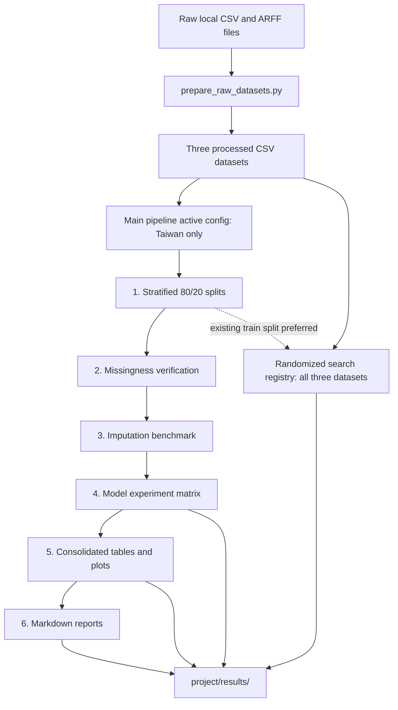

# Architecture and data flow

## Components

The repository is a local research pipeline. It has no HTTP API, user interface, database service, Docker deployment, or background worker. The input data is bundled as CSV and ARFF files; generated artifacts are CSV tables, plots, Markdown reports, and logs.

### Data preparation

`project/src/prepare_raw_datasets.py` standardizes three inputs into CSV files with a binary `target` column:

- Taiwan bankruptcy from `data/raw/taiwan/data.csv`.
- The first-year Polish bankruptcy subset from `data/raw/polish/1year.arff`.
- A Slovak manufacturing subset assembled from the bankrupt and non-bankrupt CSVs whose filenames match the [Mendeley Data, version 2](https://data.mendeley.com/datasets/j89csb932y/2) release.

The three processed CSVs are already committed under `project/data/processed/`, so preparation is not required for a normal experiment run. The preparation script writes to those same paths; review the Git diff if you rerun it.

### Main benchmark pipeline

`project/src/config.py` is the main pipeline's source of seeds, feature-missingness grid, model registry, output paths, and active datasets. The current `DATASETS` mapping enables only `taiwan_bankruptcy`.

`project/src/run_experiments.py` executes the following stages:

1. **Prepare splits** — make stratified 80/20 splits for active datasets at random states `42` and `123`. The current configuration therefore creates only Taiwan splits.
2. **Verify missingness** — inject MCAR, MAR, and MNAR at rates 5%, 10%, 15%, 20%, 30%, and 40% into training features and check the achieved total feature-cell rate against a 0.01 tolerance.
3. **Benchmark imputation** — measure the configured imputation methods on each missingness scenario.
4. **Run model experiments** — evaluate the model/imputation/missingness matrix. Experiment seeds are `44` and `111`. Results are persisted as combinations complete so a run can resume.
5. **Consolidate** — combine results into summary tables and plots.
6. **Generate reports** — write the Markdown reports from current tables.

`project/src/experiment_runner.py` coordinates scenario generation and persistence. `missingness.py`, `imputation.py`, `models.py`, and `evaluation.py` contain the core experiment steps. `consolidation.py` and `reporting.py` handle downstream artifacts.

### Randomized search

`project/src/random_search_pipeline.py` has its own three-dataset registry (`GRID_DATASETS`), separate from the main pipeline's `config.DATASETS`. It searches only the eight classical models. Its defaults are 150 sampled candidates, three seeds, and five stratified folds, with `average_precision` as the refit metric.

The loader prefers a precomputed training split, but falls back to the entire processed CSV when the split is absent. Since the main split step only creates Taiwan splits, the fallback is used for the Polish and Slovak datasets unless their splits are prepared separately. A search that uses the full CSV should not be described as leaving a held-out test set untouched.

## Data-flow diagram

## Output and persistence

All benchmark outputs are under `project/results/`, which is excluded from Git by `.gitignore`. The split CSVs are written under `project/data/splits/`. The current `.gitignore` does not exclude that split directory, so a local run can show generated splits as untracked files.

The experiment runner writes its main results CSV atomically through a temporary sibling file before replacing the target CSV. Random search saves full results after each dataset/model pair. These persistence paths support resuming long-running jobs; they do not make the experiment matrix inexpensive.

## Model dispatch and access

Classical estimators are built in `models.py`; XGBoost, LightGBM, CatBoost, TabPFN, and TabICL are dispatched to their corresponding libraries. GPU use is opportunistic for XGBoost and LightGBM. The foundation models have separate availability/access behavior; TabPFN is skipped when its required token is missing. The Python package list in `project/requirements.txt` does not pin versions or define a Python compatibility matrix.

## Ancillary scripts

- `_class_balance.py` prints target counts for processed files and any existing split CSVs; run it from the repository root.
- `build_report.py` creates a Slovak-language DOCX report from per-dataset result directories. Those result directories are not part of this clone, and this script is separate from the main Markdown report step.
- `project/check_models.py` reports whether a small set of model packages can be imported. It does not run models or serve as automated test coverage.
